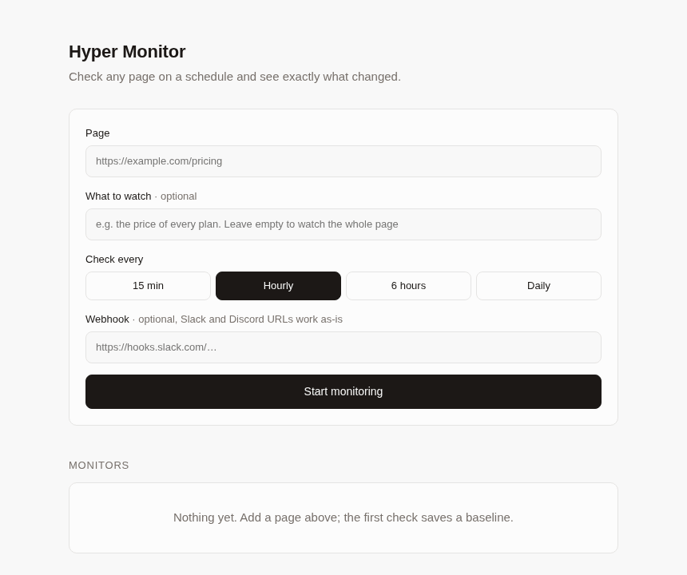

# Hyper Monitor

**Built with [Hyperbrowser](https://hyperbrowser.ai)** · [Live demo](https://hyper-monitor-three.vercel.app)

Check any page on a schedule and see exactly what changed.



<sub>Demo uses httpbin.org/uuid, which returns a new value on every load.</sub> Optionally describe what to watch ("the price of every plan") and get a webhook when it changes. Only needs a Hyperbrowser API key.

## How it works

```
every 30s ──► due monitors, one at a time
                │
                ├─ whole page   → Hyperbrowser scrape   → markdown
                └─ "what to watch" → Hyperbrowser extract → JSON
                │
                ▼
     compare with last snapshot ──► changed? save a diff + POST webhook
```

- **First check saves a baseline.** Later checks are compared to it, line by line.
- **Stable AI extraction.** Extracting with only a prompt can format the same data differently between runs (`"£51.77"` vs `51.77`), or read a vague field differently (`"Bar widget"` vs `"Omarchy Quattro"`), which would look like a change. On the first check the app locks the result's shape as a JSON Schema, with the first values as examples. When a later check looks different, it extracts once more and only reports the change if it repeats.
- **Pages that fail to load are errors, not changes.** A 404, 500 or DNS failure shows up as a failed check and is retried in 5 minutes.
- **Checks run one at a time**, with a 3 minute timeout each, so usage stays predictable and the free plan's single browser is enough.

## Run it

```bash
npm install
cp .env.example .env.local   # add your HYPERBROWSER_API_KEY
npm run build && npm start   # http://localhost:3000
```

The scheduler starts with the server, so keep it running. Data is stored in `data/db.json`.

## Deploy on Vercel

Vercel doesn't keep a server running or files on disk, so the deployed app uses:

- **Upstash Redis** for storage: add it from the Vercel Marketplace; it sets `KV_REST_API_URL` and `KV_REST_API_TOKEN`.
- **`/api/cron`** to run due checks, called every 15 minutes by the included GitHub Actions workflow (and daily by Vercel Cron as a backup). Set `CRON_SECRET` in Vercel, the same value as a repo secret `CRON_SECRET`, and your deployment URL as a repo variable `APP_URL`.
- **`OWNER_KEY`** to make it a public demo: visitors can add up to 5 pages (checked every 6 hours or daily, removed after 24 hours, no webhooks, 50 checks a day in total), and your own monitors are protected. Open the site once with `?key=YOUR_OWNER_KEY` to unlock full access in that browser.

## Webhooks

When a change is found, the app POSTs JSON to your webhook. Slack and Discord incoming-webhook URLs work as-is (`text` / `content`):

```json
{
  "text": "Change on https://example.com/pricing (price of every plan): +1 / -1 lines\n- Pro: $20\n+ Pro: $24",
  "content": "…same as text…",
  "monitor": { "id": "…", "url": "https://example.com/pricing", "watch": "price of every plan" },
  "change": { "id": "…", "at": "2026-10-11T09:05:42.891Z", "added": 1, "removed": 1 }
}
```

## Notes

- Each check is one Hyperbrowser scrape or extract job. "What to watch" monitors run extract twice on the first check (to lock the schema) and when confirming a possible change.
- There is no login: run it for yourself, don't expose it publicly.
